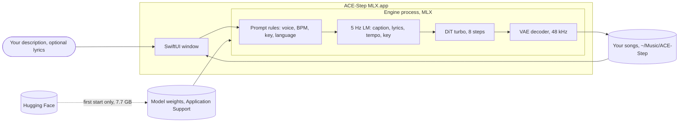

# ACE-Step MLX

Type a sentence, get a song. A native macOS app for Apple Silicon Macs with 16 GB of memory that
runs [ACE-Step 1.5](https://github.com/ace-step/ACE-Step-1.5) on your Mac, with every model on
MLX. An independent project, not affiliated with the ACE-Step authors.

Version 0.4.0, a research prototype.

## Scope

| | In scope | Not in scope |
|---|---|---|
| Input | A description of the song, in English or Italian; optionally your own lyrics | Audio input: covers, remixes, extending a track |
| Output | A 30 s song with or without vocals, as WAV, kept with its lyrics and seed | Longer songs from the window, stems, MIDI |
| Controls | None besides your lyrics: voice, tempo and key come from the words of the description | Model choice, steps, guidance, LoRA |
| Machine | Apple Silicon, 16 GB, macOS 14 or later (tested on 26.4); no network after a one-time 7.7 GB download | Intel Macs, Windows, Linux; 8 GB Macs (not tested) |
| Status | Research prototype, measured on a Mac mini M4 16 GB; a download signed with a Developer ID and notarized by Apple | The laptop preset is not measured yet |

## How it works



The window sends your description to an engine that runs inside the app. The engine reads what
it can from your words (a voice or none, a BPM, a key), lets the language model write the
caption, lyrics and metadata, and renders the song with the diffusion model and the VAE. The
window always says what is happening, and the engine gives its memory back when the app has been
idle for a while.

## Get it

Download `ACE-Step-MLX-<version>-mac.zip` from the
[latest release](https://github.com/fabriziosalmi/acestep-mlx/releases/latest), unzip it and move
ACE-Step MLX to Applications. The app is signed with a Developer ID and notarized by Apple; the
release notes give the zip's SHA-256. It needs Apple Silicon, 16 GB of memory, macOS 14 or later
and about 10 GB of free disk; the first start downloads the models, 7.7 GB, once.

Or build it from source (Xcode or the Command Line Tools and [uv](https://github.com/astral-sh/uv)
as well):

```sh
git clone https://github.com/ace-step/ACE-Step-1.5 ~/acestep-f0/ACE-Step-1.5
git clone https://github.com/fabriziosalmi/acestep-mlx ~/acestep-mlx
cd ~/acestep-mlx/app
./scripts/bundle.sh            # builds "build/ACE-Step MLX.app", signed ad hoc
open "build/ACE-Step MLX.app"  # the first start downloads the models
```

Then type a description (or click one of the examples), optionally open "Add your own lyrics",
and press Make song (Cmd-Return). Songs play in the list (Space plays the selected one), drag out
to Finder or a DAW, and stay in `~/Music/ACE-Step`.

## What to expect

Measured on a Mac mini M4 16 GB:

| | |
|---|---|
| App size | 0.95 GB |
| First start | 7.7 GB of models downloaded once (16 min on our line), every weight file checked |
| Ready to make songs | about 33 s after the app opens |
| A 30 s song | about 20 s |
| Memory while making a song | peak 11.8 GB, about 1.2 GB more with vocals |
| Memory when idle | the engine stops after 20 min on a desktop Mac, 2 min on a laptop; the next song loads it again in about 33 s |

Known limits:

- Freetekno at 180 BPM often comes out broken (5 of 8 clips in the listening tests).
- Without a BPM in the description the language model can pick odd tempos; write one ("85 bpm")
  if it matters.
- With your own lyrics, songs are still 30 s, so only the first lines of a long text are sung.

## For developers

### How a song is made

The app runs `python -m acestep_mlx.engine_service` with the Python in
`ACE-Step MLX.app/Contents/Resources/runtime`. On the first start the engine downloads the weights it
needs from Hugging Face at pinned revisions, checks the sha256 of every weight file and marks
them done, so later starts need no network (`engine/acestep_mlx/models.py`); upstream's own
download, which would also fetch the 1.7B LM, is never used. The engine then loads the models
once and serves one request per line on stdin; stdout carries protocol events only (`download`,
`ready`, `phase`, `done`, `error`). DiT, VAE, text encoder, condition encoder, audio tokenizer
and detokenizer run on MLX with the stored bf16 weights and fp32 compute; torch is left as
upstream's orchestration code. The 5 Hz LM runs on upstream's MLX backend.

Defaults (`engine/acestep_mlx/recipe.py`, `prompt_rules.py`):

- The LM turns the prompt into a caption, lyrics and metadata.
- A prompt that names no voice (Italian or English word list; "senza voce", "no vocals" and the
  like win) makes an instrumental.
- A BPM (30-300) or a key written in the prompt constrains the LM; otherwise the LM chooses.
- Songs are 30 s; duration is never read from the prompt.
- DiT `acestep-v15-turbo`, 8 steps, shift 1.0; LM `acestep-5Hz-lm-0.6B`.
- The seed is drawn by the engine and used by both the LM and the DiT, so the seed in
  `song.json` reproduces the song.

These defaults were kept by blind A/B listening tests, with each decision rule written before
any clip was made (`bench/n5`, `bench/n6`): shift 3.0, LM 1.7B and the literal prompt did not
win clearly; the forced BPM won 3 of 3.

Request options, not shown in the window: `literal` (the prompt goes to the DiT as written),
`vocals` (true or false, instead of the word list), `duration` (10 s up to the preset's maximum),
`format` (`wav`: 32-bit float, raw; `mp3`: 320 kbps, peak at -1 dBFS, encoded by libsndfile),
`like` (a song folder: same text and metadata, new seed; the window's "Another like this"), and
`lyrics` (the window's own lyrics: sung as written, always with a voice, and the prompt is the
caption as written; the language comes from the lyrics' own words for Italian, English, Spanish,
French, German and Portuguese, else from the LM, and the LM, through upstream's `format_sample`,
picks BPM and key; `bench/n9`, `bench/n10`).

Each song is a folder `~/Music/ACE-Step/YYYYmmdd-HHMMSS-<id>/` with the audio and `song.json`
(prompt, caption, lyrics, metadata, seed, models, render time).

### Measurements

| | Result |
|---|---|
| App size | 0.95 GB (1.31 GB before leaving out the 51 distributions no engine path imports, `bench/n11`) |
| First start: model download | 7.71 GB in 958 s on this line, every weight file's sha256 checked |
| Engine start (DiT, LM 0.6B, text encoder) | 33 s (38 s the very first time, compiling bytecode) |
| 30 s song | 21.8 s, peak 11.78 GB |
| 240 s song | 130 s, peak 12.21 GB (13.40 GB with vocals) |
| Engine at rest with models loaded | 8.9 GB |
| After the idle stop | the engine process is gone within 1 s |
| Next song after the idle stop | 33 s to load, 53-54 s to a 30 s song |
| Audio vs upstream's fp32 path, same inputs | SNR 77.7 dB |
| Audio from the app vs the development install, same seed | identical samples |

Peaks are the `/usr/bin/time -l` peak memory footprint of the engine process. Song time grows
linearly, about 0.5 s per second of music; memory barely grows with duration. Upstream with its
defaults does not fit in 16 GB on this machine (MPS out of memory). More limits:

- Without a BPM in the prompt the 0.6B LM picked 40-50 BPM for an Italian folk ballad in 3 of
  6 runs, and it does not always follow the voice asked for.
- The extra memory of a song with vocals is not attributed yet.
- After a failed download, Try again starts it over; files already complete are kept by
  huggingface_hub, but resuming was not measured.
- huggingface_hub writes its download log to `~/.cache/huggingface/xet/logs`, outside the app's
  folders.

### Presets

The app picks `laptop` on a Mac with an internal battery and `mini` otherwise
(`ACESTEP_PRESET` overrides).

| Preset | LM | Longest song | Idle stop |
|---|---|---|---|
| `mini` | 0.6B | 240 s | after 20 min |
| `laptop` | 0.6B | 30 s | after 2 min |

The laptop preset has not been measured on a laptop; its 30 s cap is a precaution.
`ACESTEP_IDLE_SECONDS` overrides the idle period.

### Build details

`bundle.sh` takes upstream's package and `uv.lock` from commit ca1e85f of the upstream clone
(`UPSTREAM` points at another one), installs the locked dependencies with hashes required and
removes the ones listed in `scripts/prune.txt`. The disk needed is the app 0.95 GB, the weights
7.7 GB and bytecode 0.1 GB; the runtime cached under `app/build/` shares its files with the app.
The build has been run on the Mac mini only, not on a clean Mac. The engine log is
`~/Library/Logs/ACE-Step/engine.log`.

`scripts/notarize.sh` signs the built app with a Developer ID (every Mach-O file inside, with the
hardened runtime and a timestamp, no entitlements), notarizes it with `notarytool`, staples the
ticket and zips it as `build/ACE-Step-MLX-<version>-mac.zip`; it runs where the certificate is
(`SIGN_ID`, `NOTARY_PROFILE`). Checked in `bench/n12`: accepted by Apple and by Gatekeeper, and
the signed app makes the same song, sample for sample.

### Development install and checks

The engine tests and `swift run` use a development install: upstream's venv and checkpoints in
`~/acestep-f0/ACE-Step-1.5` (`bench/f0/setup.sh` makes them) and this repo in `~/acestep-mlx`.
`ACESTEP_RUNTIME` points the app's code at an app's runtime instead; `ACESTEP_PYTHON`,
`ACESTEP_ENGINE`, `ACESTEP_PROJECT` and `ACESTEP_SONGS` override single paths.

```sh
cd ~/acestep-mlx/engine && ~/acestep-f0/ACE-Step-1.5/.venv/bin/python -m unittest discover -s tests
cd ~/acestep-mlx/app && swift test             # needs Xcode (Swift Testing)
cd ~/acestep-mlx/app && swift run AceStepE2E   # one real song through the app's model
ACESTEP_RUNTIME="$PWD/build/ACE-Step MLX.app/Contents/Resources/runtime" swift run AceStepE2E  # the app's engine
```

### Layout

- `engine/acestep_mlx/`: the lean engine (a subclass of upstream's handler), the MLX modules, the
  recipe, the model download and the JSON-lines service; tests in `engine/tests/`.
- `app/`: SwiftPM package. `AceStepKit` (engine process, state, history), `AceStep` (the
  window), `AceStepE2E` (end-to-end check), `scripts/bundle.sh` (the app with its engine).
- `bench/`: one folder per measured step, each with its prediction written before the run and
  the result after it; raw logs, listening-test keys and votes in `bench/results/`.

## License

MIT (`LICENSE`). The app bundles upstream's `acestep` package with its own MIT license
(`Contents/Resources/runtime/upstream/LICENSE`) and the third-party packages of upstream's lock,
each under its own license; the model weights are downloaded from Hugging Face under theirs.
